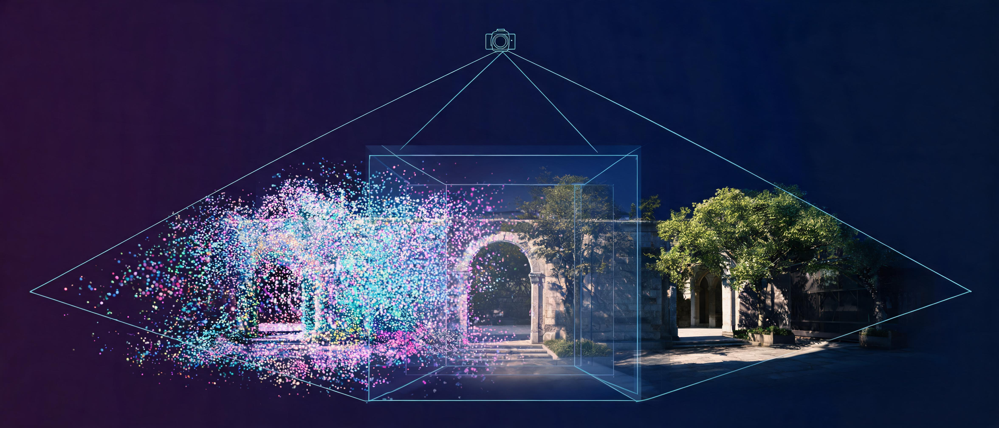
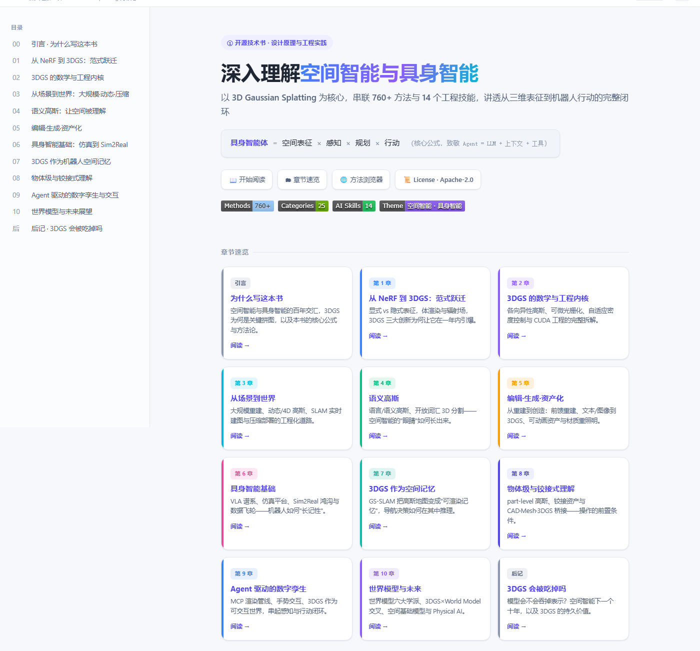

<div align="center">



# Awesome Gaussian Skills

### The Most Comprehensive 3D Gaussian Splatting Catalog — 1011 methods, 26 Categories, Interactive Explorer

**You shouldn't search 20 repos for 3DGS papers. This is the only one you need.**

[](https://github.com/jaccen/Awesome-Gaussian-Skills/stargazers)
[](https://jaccen.github.io/Awesome-Gaussian-Skills/)
[](references/3dgs-methods-overview.md)
[](skills/)
[](skills/3dgs-code-reviewer/)
[](LICENSE)
[](CONTRIBUTING.md)

[English](README.md) | [中文](README_CN.md)

</div>

<details>
<summary><b>Table of Contents</b></summary>

- [Why This Repo?](#why-this-repo)
- [Live Demo](#live-demo)
- [Quick Start](#quick-start)
- [Integrations](#integrations)
- [Online Book](#-online-book-spatial--embodied-intelligence)
- [What's New (Oct 2026)](#whats-new-oct-2026)
- [Knowledge Base](#knowledge-base-1011-methods-26-categories)
- [18 AI-Powered Skills](#18-ai-powered-skills)
- [Visualization Samples](#visualization-samples)
- [Research Innovation Highlights](#research-innovation-highlights)
- [Roadmap](#roadmap)
- [Architecture](#architecture)
- [SplatVerse Studio](#splatverse-studio-short-video-creation)
- [Contributing](#contributing)
- [Citation](#citation)
- [Ecosystem & Acknowledgments](#ecosystem--acknowledgments)
- [License](#license)
- [Sponsor & Community](#sponsor--community)
- [Star History](#star-history)

</details>

## Why This Repo?

Other awesome lists give you paper titles. **We give you paper titles + an AI toolkit that makes you faster.** The canonical lists catalog the ecosystem for humans; this repo makes it consumable by AI agents — **let your AI read the papers for you**.

| What You Need | Other Lists | This Repo |
|---------------|-------------|-----------|
| Browse papers | Static markdown table | [Interactive explorer](https://jaccen.github.io/Awesome-Gaussian-Skills/): search, filter, sort |
| Compare methods | Open 2 papers side by side | 10+ dimension auto-comparison |
| Avoid code bugs | Discover after submission | 104 known bug pattern detection |
| Design experiments | Guess baselines & ablations | Venue-tailored experiment plan |
| NeRF → 3DGS | Trial-and-error porting | Step-by-step migration guide |
| CAD → 3DGS | No coverage | 40+ method conversion pipeline |
| Patent filing | Manual from scratch | Auto-generated claims & specs |

## Live Demo

**[Try the Interactive Method Explorer →](https://jaccen.github.io/Awesome-Gaussian-Skills/)**

Search 1011 Methods instantly, filter by category, sort by citations, click any method card for details.

## Quick Start

Each skill is a standalone SKILL.md file —copy it to your Agent's skills directory.

**3 commands to your first AI-powered 3DGS workflow:**

```bash
git clone https://github.com/jaccen/Awesome-Gaussian-Skills.git

# Option 1: Claude Code
cp -r Awesome-Gaussian-Skills/skills/* .claude/

# Option 2: Cursor
cp -r Awesome-Gaussian-Skills/skills/* .cursor/rules/

# Option 3: One-Click Install
curl -sSL https://raw.githubusercontent.com/jaccen/Awesome-Gaussian-Skills/main/scripts/setup.sh | bash
```

Then ask your Agent: *"Compare 3DGS and 2DGS rendering formulations"*

## Integrations

This repo ships as both **AI agent skills** and an **MCP server**, so it works across agent runtimes and MCP clients — the knowledge base is consumable by your AI agent, not just by you:

| Client | How to use |
|---|---|
| **Claude Code / OpenClaw** | `/plugin marketplace add jaccen/Awesome-Gaussian-Skills` → install `gaussian-research`, `gaussian-engineering`, or `gaussian-domain` (18 skills in 3 plugins); or load `skills/` directly (see `CLAUDE.md`); MCP server via the config below |
| **DSH (DeepSeek Harness)** | `dsh plugin --profile web add jaccen/Awesome-Gaussian-Skills` — the 18 skills + MCP renderer auto-mount via `cordis.patch.yml` |
| **Claude Desktop / Cursor / Cline** | copy the MCP stdio config from [`.marketplace/mcp-servers/client-configs.md`](.marketplace/mcp-servers/client-configs.md) |
| **Any MCP client** | `command: node`, `args: [/path/to/mcp-server/dist/index.js]`, transport: stdio — 34 tools (21 core + 13 experimental) |

The MCP server exposes **34 tools** — 21 core (`import_scene`, `set_camera`, `modify_gaussians`, `render_frame`, `sculpt_pipeline`, SLAT latent editing, …) + 13 experimental stubs — see [`mcp-server/README.md`](mcp-server/README.md) and [`.marketplace/mcp-servers/mcp-metadata.json`](.marketplace/mcp-servers/mcp-metadata.json).

## 📖 Online Book: Spatial & Embodied Intelligence

> A full open-source technical book, built around **3D Gaussian Splatting** as the spine and weaving together **spatial intelligence** and **embodied intelligence** into one closed loop: *representation → perception → planning → action*.

**[📖 Read the Book →](https://jaccen.github.io/Awesome-Gaussian-Skills/spatial-embodied-intelligence.html)**

<div align="center">



</div>

**Core formula** (echoing `Agent = LLM + Context + Tools`):

> **Embodied Agent = Spatial Representation × Perception × Planning × Action**

<details>
<summary><b>What's inside — 13 chapters + hands-on prelude & capture SOP, every method name anchored to this repo's real data (1011 Methods, 26 categories, 18 skills), zero fabrication</b></summary>

| # | Chapter | Focus |
|---|---------|-------|
| 引言 | Why this book | Why 3DGS is the key puzzle piece of Physical AI |
| 前 | Landing prelude: should you, can you | Tech-selection matrix, eight cases where you should NOT use 3DGS, three reading paths |
| CH 01 | NeRF → 3DGS: A paradigm leap | Explicit vs implicit, the three innovations, the alpha-compositing formula |
| CH 02 | The math & engineering core | Anisotropic Gaussians, differentiable rasterization, adaptive density control, CUDA |
| 操 | Data-capture SOP | Device selection, trajectory design, seven exposure hard rules, scale calibration —the first step that decides your quality ceiling |
| CH 03 | From scene to world | Large-scale, dynamic/4D, GS-SLAM, compression & deployment |
| CH 04 | Semantic Gaussians | CLIP/DINO feature distillation, open-vocabulary 3D segmentation |
| CH 05 | Editing · Generation · Asset-ization | Feed-forward reconstruction, SDS generation, animatable assets, PBR relighting |
| CH 06 | Embodied intelligence basics | VLA lineage (RT/π0/GR00T/ReconVLA), simulation, Sim2Real |
| CH 07 | 3DGS as robot spatial memory | GS-SLAM, map-as-renderer, three tiers of spatial memory |
| CH 08 | Object-level & articulated understanding | Part-level Gaussians, URDF bridging, the CAD·Mesh·3DGS triangle |
| CH 09 | Agent-driven digital twins | MCP rendering pipeline, gesture interaction, the perception-action loop |
| CH 10 | World models & the future | Six schools of world models, 3DGS×World Model, spatial foundation models, Physical AI |
| CH 11 | Security, provenance & copyright | 3DGS watermarking, GaussTrace forensics, adversarial attacks, IP management |
| CH 12 | Capture-to-delivery: the end-to-end pipeline | Ten-stage tool selection & pitfalls, formats & coordinate systems, cost/duration estimates, project failure modes |
| CH 13 | Industry playbooks: six verticals | Museums & tourism, e-commerce, industrial inspection, AD simulation, embodied robots, surveying & mapping |
| 附 | Appendix | Datasets, evaluation metrics, delivery-metric conversion & acceptance-report templates |
| 实 | Practice index: from book to engineering | 18 engineering skills · 34 MCP tools · 1011+ method explorer, chapter-to-runnable-resource mapping |
| 后记 | Will 3DGS be eaten? | Why explicit representations will be compressed, not consumed |

</details>

Each chapter ends with hands-on exercises and links back to the repo's method tables, `references/`, and skills —so reading the book and doing the engineering are one seamless flow.

**Highlights you won't find in a paper list:**
- The six schools of world models (2026 taxonomy) and where 3DGS sits as the *only* representation that is simultaneously renderable, differentiable, and editable.
- How `GS-World`, `ManiGaussian`, and `OrbiSim` turn 3DGS into a differentiable simulation engine.
- A three-tier model of robot spatial memory (geometric → appearance → semantic) and where current GS-SLAM actually stands.

<details>
<summary><strong>Why we wrote it (and how it relates to this repo)</strong></summary>

This book is the *narrative layer* over the repo's *data layer*. The repo gives you 1011 method names, abstracts, and 18 engineering skills —but not the through-line that connects them. The book supplies that through-line: it argues *why* 3DGS became the bridge between spatial intelligence and embodied intelligence, and walks every chapter back to concrete methods and skills you can use today. Read the book to understand the map; use the repo to ship the territory.

</details>

## What's New (Oct 2026)

### Latest Update (Oct 19, 2026): **v0.9.12 — Full-Library Audit + arXiv Scan: 21 New Methods (955 → 1011)** ⭐

Full-library audit plus a fresh arXiv scan admitted **21** new indexed 3DGS methods, taking the
library from **955 to 1011** (+21, +2.2%) across 8 categories — led by Compression & Streaming (+5),
Cross-Domain (+3), Autonomous Driving (+2), World Models & Spatial Intelligence (+2), SLAM (+2).
Every admitted method name is self-stated in its own paper's title/abstract (R9 protocol) and
indexed; **13** candidates were rejected (no self-stated method name, survey, NeRF, or 3DGS
used merely as a tool); one name collision (**X-Splat**) kept the existing entry and dropped the
newcomer.

Audit fixes: one mis-attached description (**STC-GS** — corrected to its real contribution, a
spatio-temporal coherent GS for weather-radar sequence prediction) and **16** blank descriptions
backfilled. Full arXiv-ID re-verification across **1,462** unique IDs (1,461 reachable; the single
unresolved ID was a historical note rather than a live record). All data carriers
(`methods.json` / CSV / `methods.html` / `abstracts.js` / reference docs) re-verified at **1011**,
name sets identical. See [changelog](changelog/2026-10-19.md).

### Previous Update (Oct 15, 2026): **v0.9.11 — Research Expert Team Deep Expansion: Methodology Core + 15 Master-Paper Studies** ⭐

Pure skill-content release — **no carrier changes** (955 methods / 26 categories / 18 skills stay).
`research-expert-team` grew from a nine-role router into a **two-layer methodology asset**:

- **Methodology core (program layer)** — executable procedures distilled from 15 top-cited
  exemplars: topic-selection engine (M1-M4 + five opening-sentence variants), argumentation
  skeletons (T1-T3 + representation-paper techniques B.5), 16 experiment patterns (C1-C16),
  eight reviewer must-ask questions with preempts (D1-D8), nine value amplifiers.
- **Master-paper evidence base (5 directions, 15 papers)** — full-text dissections of Kimera,
  ConceptGraphs, ReAct, MetaGPT, Toolformer, Generative Agents, Voyager, DreamFusion,
  DreamGaussian, 3DGS, 4DGS, SuGaR, NeRF, Instant-NGP, DUSt3R (citations verified via
  Semantic Scholar).
- **3DGS paper-drafting blueprint** — three writing rules (motivation upgrade / symbol
  unification / painpoint→resource-metric mapping), five-section placement table, and a
  pre-submission checklist, fused with `cg-paper-writing` templates.
- **Expert-review audited** — all 10 re-fetched papers' numeric claims line-verified; 2025-2026
  latest-paper landscape notes added per direction.

Also fixed a pre-existing badge caliber bug (skills count 17 → 18; CN README was stale at 15).
See the work log in [changelog/2026-10-15.md](changelog/2026-10-15.md) and the release record
[changelog/2026-10-15-v2.md](changelog/2026-10-15-v2.md).

### Previous Update (Oct 13, 2026): **v0.9.10 — AIGC Content Creation Category + Research Expert Team Skill** ⭐

New category **AIGC Content Creation** (22 methods; taxonomy 25 → 26): the AI-generated-content
creation layer over 3DGS — text/image → 3DGS scenes and assets, generative scene reconstruction,
stylization, artistic fonts, avatars. Anchored by `DiffSplat`, `Dragen3D`, `PSGS`, `Lyra`, `CSD`,
`SplatFont3D` plus 2026 entries (`VirSqueezer`, `CGGS`, `UniWorld-View`, `OmniStyle-INR`,
`Flex4DHuman`, `LightHarmony3D`); the pre-existing `CGGS` entry was completed with its arXiv ID
(2607.03819) and re-categorized. New skill **`research-expert-team`** (17 → 18 skills): a nine-role
full-cycle research team — idea evaluation, innovation mining, simulated peer review, academic
polishing, AIGC-trace hygiene (publication hygiene), framework & venue compliance, strict venue-format
writing, experiment design, experiment analysis — with method-selection tables for the three frontier
directions (Ontology / Super Agents / AIGC Content Creation). Library **934 → 955**; all data carriers
re-verified at 955, name sets identical. See [changelog](changelog/2026-10-13-v3.md).

### Previous Update (Oct 13, 2026): **v0.9.9 — Knowledge-Base Expansion: 900 → 934, Two New Skills** ⭐

**34** new indexed methods admitted, taking the library from **900 to 934**, with the
taxonomy growing **23 → 25 categories**: two new cross-cutting categories — *Ontology & Knowledge
Representation* (12 methods) and *Super Agents & Agentic AI* (20 methods). Two new skills
shipped — `ontology` (3D scene graphs, spatial ontologies, neuro-symbolic reasoning) and
`super-agent` (multi-agent LLM system design, 3D/spatial agent integration) — skill count
**15 → 17**. CGS-SLAM name-collision remediated (colliding newcomer dropped; original
IROS 2025 entry restored). All data carriers re-verified at **934**, name sets compared entry
by entry; site-wide caliber unified to 934 / 25 / 17. See [changelog](changelog/2026-10-13-v2.md).

<details>
<summary><b>Earlier updates (v0.9.8 and before)</b></summary>

### Previous Update (Oct 20, 2026): **v0.9.8 — World Models Category Reinforcement (896 → 900)** ⭐

Targeted reinforcement of the thinnest category. **4** new indexed 3DGS-based World
Model / Spatial Intelligence methods admitted, taking the library from **896 to 900**. The
World Models & Spatial Intelligence category grew from 8 → 12 methods:
`HY-World 2.0`, `F3DGS` (federated multi-agent world modeling), `4DGS-WAM` (object-centric
world action model), `Cloth-Splatting` (3DGS cloth state estimation). Two missing arXiv IDs
backfilled (`Holi-Spatial` → 2603.07660, `Spatial-TTT` → 2603.12255); two entries flagged
`unverified` pending source check (`APEIRIA`, `S²AM3D`). `GSMem` found already in library
under Embodied AI & Robotics — not duplicated. See [changelog](changelog/2026-10-20.md).

### Previous Update (Oct 12, 2026): **v0.9.7 — Manual Admission: 15 New Methods (881 → 896)** ⭐

Manual admission of **15** new indexed 3DGS methods, taking the library from
**881 to 896** (+15, +1.7%). Admissions span 9 categories: Acceleration (`H2-Ray`, `TileSkipper`,
`SplatQ`), Feed-Forward (`CompactSplat`, `DeltaSplat`, `DensiTok`), Embodied AI & Robotics
(`Splat2Act`, `2DGS-Planner`, `NovaSplat`), plus `OuroWorld` (Dynamic & 4D), `PAM-ToD` (HDR & Relighting),
`FlyMark` (Security), `GSCV` (Compression & Streaming), `OpenSplatGraph` (Language & Semantic),
`PCAsplat` (Surface & Rendering). Every admitted method name is self-stated in its own paper's
title/abstract (R9 protocol) and indexed. **12** candidate papers were rejected for lacking a
self-stated method name, being benchmark-only, NeRF (not 3DGS), or using 3DGS merely as a tool. All data
carriers (`methods.json` / CSV / `methods.html` / `abstracts.js` / reference doc) re-verified at **896**,
name sets compared entry by entry. No method name was fabricated.

See [changelog/2026-10-12.md](changelog/2026-10-12.md) for the full admission list.

### Update (Oct 7, 2026): **v0.9.6 — Manual Admission: 9 New Methods (872 → 881)** ⭐

Manual admission of **9** new indexed 3DGS methods, taking the library from
**872 to 881** (+9, +1.0%). Admission includes **Speedy-Splat** (CVPR 2025, precise tile
intersection + efficient Hessian-based pruning, 6.71× render speedup) and **8** recent September 2026
papers: `AESplat` (pose-free feed-forward), `AGILE-GS` (anchor-guided NBV), `OC-GS` (irregular turntable),
`ClearGS` (handheld video), `ChronoFuseGS` (multi-temporal fusion, PG 2026), `TangoGS` (cross-scale
compact), `RRTO-CF3DGS` (COLMAP-free), `Observation-Gram` (SH compression).
All data carriers (`methods.json` / CSV / `methods.html` / `abstracts.js` / reference doc)
re-verified at **881**, name sets compared entry by entry. No method name was fabricated.

See [changelog/2026-10-07.md](changelog/2026-10-07.md) for the full admission list.

### Update (Sep 21, 2026): **v0.9.5 — Daily arXiv Scan: 13 New Methods (859 → 872)** ⭐

Routine daily arXiv scan admitted **13** new indexed 3DGS methods, taking the library from
**859 to 872** (+13, +1.5%). Admissions span Surface & Rendering, Feed-Forward, Large-Scale,
Compression, Sparse-View, Cross-Domain, Embodied AI & Robotics, Dynamic, and Language & Semantic
categories (incl. `LiteTex-GS`, `GrapeSplat`, `VDGS`, `CRP-GS`, `NormLift`). **7** candidate papers
were rejected for failing the verification protocol — benchmarks without a self-stated method name,
descriptive-only paper titles, or 3DGS used merely as a tool. All data carriers
(`methods.json` / CSV / `methods.html` / `abstracts.js` / reference doc) re-verified at **872**,
name sets compared entry by entry. No method name was fabricated; the library's
"every entry arXiv-verifiable" guarantee holds.

See [changelog/2026-09-21-v3.md](changelog/2026-09-21-v3.md) for the full admission list.

### Update (Sep 21, 2026): **v0.9.4 — Multi-Channel Harvest: 700 → 859 Methods + Accuracy Overhaul** ⭐

Knowledge base expanded from **700 to 859 verified methods** (+159, +22.7%) through a multi-channel arXiv
harvest over the last 150 days. Six query families (`cs.CV` / `cs.GR` / `cs.RO` / full-corpus /
`abs:"3D Gaussian Splatting"` / `ti:"Gaussian Splatting"`) returned 395 candidates; after verification
**162** were admitted. Also in this release:

- **Verification protocol (R1–R6)**: every admission requires the paper's *self-stated* method name,
  reproduced in its own abstract; multi-word names must contain a proper-noun token — this alone rejected
  67 descriptions masquerading as method names (`Capacity-Controlled`, `Scene-Level`). 114 borderline
  candidates were read individually; 25 adjudicated in, the rest dropped.
- **Accuracy repairs**: 57 reference links had a displayed arXiv ID differing from the hyperlinked one
  (all had the correct ID displayed, wrong link). **13 mis-attributed entries deleted** — e.g.
  `Dynamic 3D Gaussians` pointed at 2309.13114, which is actually a magnetic spin-glass physics paper,
  and `GS-LRM-v2` pointed at DOF-GS. All now verified against the arXiv API.
- **AIGC traces removed** from 29 text files; 21 historically corrupted JPEGs restored and re-stripped safely.
- **`README_CN.md` recovered** from double-encoding corruption that had mangled every Chinese string.
- **Full carrier sync** — `methods.json` / CSV / `methods.html` / `abstracts.js` / reference doc
  all verified at **881**, name sets compared entry by entry rather than by count alone.

**Adjudication wave (same day).** A second pass resolved every name carrying a derived suffix or
colliding with another entry: `Scaffold-GS+` and `GaussianSplatting-SLAM-v2` deleted (no such paper
exists), `Luminance-GS++` renamed to its self-declared base name, and `Spark 2.0`'s description
corrected — it is World Labs' open-source WebGL2 splat renderer, not an NVIDIA robotics simulator.
Two independent papers both self-name `GeoGS-SLAM` (2607.07452 and 2607.11184, disjoint author lists);
they are two methods, not a sequel, and are now disambiguated. 862 → **859**.

See [changelog/2026-09-21.md](changelog/2026-09-21.md) and
[changelog/2026-09-21-v2.md](changelog/2026-09-21-v2.md) for the full audit trail.

Latest update (Sep 20): **v0.9.2 —Scene Agent + Mapmost Engineering Wave: 5 New Methods + 6 Skill Enhancements**. Knowledge base expanded from 692→ 97 methods. Added 5 scene-generation Agent papers: **SceneSmith** (ICML 2026 Spotlight, MIT CSAIL —hierarchical designer-critic-orchestrator VLM agents for simulation-ready indoor scenes), **Scenethesis** (ICLR 2026, NVIDIA —training-free LLM+vision agentic framework), **SceneGenAgent** (ACL 2025 —LLM coding agent for industrial scenes), **SceneConductor** (arXiv —multi-agent orchestration from single image), **SceneAssistant** (arXiv —visual-feedback agent for open-vocabulary scene generation). Injected Mapmost production engineering knowledge into 4 skill files: 3DGS individualization (单体化) in best-practices.md, LOD streaming + seam-fix + adaptive partition training in best-practices.md, 3DGS+3DTiles multi-source fusion in gis-toolchain.md, LUT color grading in tech-stack.md, Mapmost as Digital Twin player with 100km² benchmark in industry-landscape.md. Categories updated: Generation +4, Embodied AI & Robotics +1.

Previous (Sep 20): **v0.9.1 —ECCV 2026 Wave: 14 New Methods**. Knowledge base expanded from 678→ 92 methods. All 14 new entries indexed or ECCV-official: **Wat3R** (underwater 3D geometry without annotations), **GeoNVS** (geometry-grounded video diffusion with GS-Adapter), **Edit3r** (instant 3D editing from unposed images), **SA-ResGS** (first residual learning for 3DGS in next-best-view selection), **GaussianLens** (on-demand localized high-res reconstruction), **Deformable Triangle Splatting** (non-convex primitive with per-edge control points), **Neural Harmonic Textures** (per-primitive harmonic feature decoding), **CubicSplat** (error-bounded differentiable vector graphics), **TetraSDF** (analytic isosurface extraction), **Heat Kernel Textures** (ECCV 2026 Best Paper —geodesic Gaussians), **GRF-Recon** (long-sequence feed-forward with global ray-field), **PriSplat** (distractor-free 3DGS via multi-view propagation), **Per-View Distractor Filtering** (training-free feed-forward artifact removal), **GS-Underwater** (controlled cross-regime underwater benchmark study). Categories updated: Surface & Rendering +5, Feed-Forward +4, Cross-Domain +2, Robustness +2, Editing +1, Embodied AI & Robotics +1. All data carriers in sync.

Previous (Sep 16): **v0.9.0 —Data Accuracy Release**. Full-library audit of every entry against the arXiv API: each arXiv ID re-verified reachable **and** matched to its paper (method name must appear in the title/abstract). **181 entries failed verification and were removed, 56 wrong-ID entries re-linked to their real papers, 5 renamed to the papers' self-declared method names**, plus 1 duplicate removed. The count is now honest instead of inflated: **678 methods, 23 categories, 568 indexed (83%), 130 code links (19%)**. Per-entry audit evidence: [docs/data-accuracy-audit-2026-09-16.md](docs/data-accuracy-audit-2026-09-16.md). See [changelog/2026-09-16-v5.md](changelog/2026-09-16-v5.md).

Previous (Sep 4): **v0.8.3 —Dynamic Scene Survey Integration: 23 New Methods**. Knowledge base expanded from 801→ 19 verified methods. Added 23 indexed dynamic scene reconstruction methods from survey paper (连振晗 et al., J CAD & CG, Jan 2026), spanning 3 categories: deformation field (LoopGaussian, CoGS, CD-GS, PGED, GPS-Gaussian, MoDGS, MoDec-GS, SpectroMotion, BARD-GS, GauFRE, ReconDreamer++), sparse-control deformation (SP-GS, Video-3DGS, SplineGS), 4D Gaussian primitive (Real-time 4DGS, PVG, 4D-rotor GS), and per-frame inter-frame transfer (3DGStream, Dual-GS, STC-GS, IGS, GFlow, DynOMo). Dynamic & 4D category: 75→ 7. New `references/dynamic-datasets.md` (11 datasets) and expanded `benchmark-data.md` (MS-SSIM/VMAF/FID metrics + 4 performance comparison tables). Experiment planner skill updated with dynamic scene design guide. See [changelog/2026-09-04.md](changelog/2026-09-04.md).

Previous (Sep 2): **v0.8.2 —Daily Update: 11 New Methods**. Knowledge base expanded from 790→ 01 verified methods. New additions span 7 categories: **BRF-GS** (hyperspectral BRDF modeling with 3DGS), **SMG** (ECCV 2026, semantic motion graph for dynamic GS), **VCAR** (ACM MM 2026, training-free 3DGS segmentation), **RealCAD** (real-world image to CAD reconstruction), **ObjectSplat** (object-level mesh splatting), **CapFrame** (ECCV 2026, text-instructed viewpoint localization), **Amortized Anchor Refinement** (continuous-time 4D reconstruction), **ATGS** (SIGGRAPH 2026, anchored temporal GS for long volumetric video), **CausalSplat** (hierarchical causal reasoning in 3DGS), **VoroTracing** (623 FPS differentiable ray tracing), **Lucida** (Real-to-Sim composable scene modeling). All arXiv IDs verified, data CI passed. See [changelog/2026-09-02.md](changelog/2026-09-02.md).

Previous (Aug 23): **v0.8.1 —Daily Update: 7 New Methods**. Knowledge base expanded from 783→ 90 verified methods. New additions span 6 categories: **LEGO** (ECCV 2026, hierarchical language GS with LLM spatial reasoning), **OutLangSplat** (UAV outdoor open-vocabulary 3D language GS), **ESVR** (IEEE VIS 2026, 3D ellipsoid sparse volume rendering with 4 orders of magnitude compression), **TRACE-GS** (sparse-view 3DGS via privileged geometric conditioning), **RORA** (single-video-to-articulated-object pipeline with Unreal Engine deployment), **OVOW** (ECCV 2026, monocular video to instance-level 4D mesh for physics simulation), **Super-Gaussian** (interactive 3DGS scene editing with VR NLI visualization). All arXiv IDs verified, data CI passed. See [changelog/2026-08-23.md](changelog/2026-08-23.md).

Previous (Aug 7): **v0.8.0 —Platform Upgrade (P0+P1+P2)**. Knowledge layer: single source of truth (`data/methods.json`, 783 methods, 23 categories) with data CI; 5 fabricated entries purged; 14 indexed frontier methods added. Capability layer: true-3DGS render loop (gsplat via HTTP-served PLY), server-authoritative scene persistence, real PLY/SPLAT export, 5 distinct prune strategies, grid-accelerated ray query, runtime arg validation, WS origin allowlist, 21 unit tests. Platform layer: Benchmark arena (`bench/`), skill orchestration contracts (`skills/_contracts/`), Router manifest loader (`scripts/router_load.py`). 13 core MCP tools (all real) + 13 experimental (gated by `INCLUDE_EXPERIMENTAL=1`). See [changelog/2026-08-07.md](changelog/2026-08-07.md).

Previous (Jul 26): **v0.5.1 —Full Method Audit & 14 New Methods**. Now 789+ Methods (775 verified unique baseline + 14 new). Full re-audit across 11 source files; all method counts unified to 789+. New additions: **GrainGS** (dynamic, 36.98 dB / 435.6 FPS / 4.67 MB), **GLAM-SLAM** (IROS 2026, outdoor decoupled SLAM), **SubSplat** (subpixel feed-forward), **ATSplat** (adaptive 3D tokens, 1136 FPS), **3D-GIMP** (3DGS inpainting), **LB-Edit** (7× lower editing latency), **FlexiAvatar** (ECCV 2026, visible-body-only optimization), **ZeroSplat** (ECCV 2026, training-free segmentation), **CaT-GS** (CVPR 2026, 10× faster rendering), **FF-ProCams** (projector-camera inverse rendering), **i3dgs** (SIGGRAPH 2026, large-scale unordered), **VIGS-SLAM** (ECCV 2026, iPhone real-time), **ECoNGS** (IEEE VIS 2026, volume visualization), **AniGS** (scene-level animation via diffusion prior). +MoDE/MoE-GS code link. Previous (Jul 24): v0.5.0 MCP Protocol Implementation. Previous (Jul 23): v0.4.3 ICML 2026 & Material/Provenance Wave —**GaussTrace** (ICML 2026), **GADA** (ICML 2026), **InvSplat**, **MGM**, **DualPhys-GS**, **StereoGS**. v0.4.4 added 3dgs-training-debugger skill (60+ runtime patterns).

| Method | Venue | Category | One-Line Innovation |
|--------|-------|----------|-------------------|
| **Proxy-GS** | CVPR 2026 Oral | Acceleration | Lightweight proxy model for 2.5x speedup with no accuracy loss |
| **Z-Order GS** | CVPR 2026 Oral | Feed-Forward | Z-order Morton curve + sparse attention O(N²)→ O(N log N) |
| **3DReflecNet** | CVPR 2026 Best Paper Candidate | Cross-Domain | 120K+ objects, 48 material combos, 3 failure modes |
| **Flux-GS** | ECCV 2026 | Acceleration | Flux-based Gaussian splatting for real-time rendering |
| **AnchorSplat** | ECCV 2026 | Optimization | Anchor-driven splatting with efficient density control |
| **ASSEMCAD** | ECCV 2026 | CAD | Assembly-aware CAD reconstruction from 3DGS |
| **WildSplat** | ECCV 2026 | Robustness | In-the-wild scene reconstruction with transient object removal |
| **NoDrift3R** | ECCV 2026 | SLAM | Drift-free dense 3D reconstruction via point map regression |
| **Axis-Shared Rasterization Accelerator** | ISCA 2026 | Acceleration | Hardware accelerator with axis-shared tiled rasterization |
| **Prune Wisely** | —| Optimization | 90% Gaussian pruning via DoG importance criterion |
| **Provable Pruning via Coresets** | —| Optimization | Coreset-based provable Gaussian pruning with bounded error |
| **StreamLoD-GS** | —| Streaming | LoD-based progressive streaming with view-dependent quality |
| **CADDreamer** | CVPR 2025 Highlight | CAD | Text/sketch → CAD B-rep generation |
| **GaussTrace** | ICML 2026 | Security | 3DGS provenance analysis via LLM reasoning for IP forensics |
| **GADA** | ICML 2026 | Feed-Forward | Geometry-aware deformable aggregation, 2.13× faster FPS |
| **InvSplat** | arXiv 2026 | Feed-Forward | Inverse feed-forward splatting with intrinsic PBR materials |
| **MGM** | arXiv 2026 | Relighting | Large material Gaussian model for relightable 3D generation |
| **DualPhys-GS** | arXiv 2026 | Robustness | Dual physics-guided 3DGS for underwater reconstruction |
| **StereoGS** | 2026 | Acceleration | Energy-efficient hardware stereoscopic GS rendering processor |

</details>

<sup>Full changelog: [`changelog/`](changelog/)</sup>

## Knowledge Base (1011 Methods, 26 Categories)

| Group | Categories | Key Topics |
|-------|-----------|------------|
| **Core Representations** | Foundation, Antialiasing, Optimization, Surface/Rendering, Image Rep. | 3DGS, 2DGS, Scaffold-GS, Mip-Splatting, GaussianImage |
| **Efficiency & Scale** | Compression, Acceleration, Large-Scale, Feed-Forward | Compact-3DGS, BlitzGS, HiGS, VEDAL, VG²GT |
| **Understanding & Semantics** | Language/Semantic, Generation, Autonomous Driving | LangSplat, DreamGaussian, StreetNVS |
| **Dynamic & Spatial** | Dynamic, HDR, SLAM, Sparse-View, Spatial Intelligence | DSD-GS, WebSpline, GGD-SLAM, Holi-Spatial, Spatial-TTT |
| **Applications** | Human/Avatar, Editing, Relighting, CAD, Cross-Domain, Simulation, Robotics, +14 more | AlbedoEdit, KDH-CAD, LEGS, TIDES, 3DEditSafe |

> Download full database: [CSV](3dgs-methods-overview.csv) | Full analysis: [references/3dgs-methods-overview.md](references/3dgs-methods-overview.md)

<details>
<summary><strong>Full Category Table (26 categories)</strong></summary>

**Core Representations**

| Category | Description | Methods |
|----------|-------------|---------|
| Foundation (26) | Core 3DGS representations and basic variants | 3D Representation Survey, 3DGEER, 3DSGS |
| Optimization (51) | Training objectives, density control, convergence | AdaGScale, AdpSplit, ArtifactWorld |
| Surface & Rendering (66) | Surface extraction and rendering-formulation innovation | 2D-SuGaR, 3DSS, AmbiSuR |

**Efficiency & Scale**

| Category | Description | Methods |
|----------|-------------|---------|
| Compression & Streaming (53) | Lightweight, mobile, and progressive streaming | CAGS, Clustered Codebook VQ, CodecSplat |
| Acceleration (26) | Training and inference speedup | 3DGS\u00B3, Axis-Shared Rasterization Accelerator, DDF-GS |
| Large-Scale (21) | City-scale and distributed scene management | BlitzGS, CaT-GS, City-Level 3D Surface |
| Feed-Forward (90) | Generalizable single-pass reconstruction (incl. foundation models) | AdaptSplat, AnchorSplat, AnyCity |

**Understanding & Semantics**

| Category | Description | Methods |
|----------|-------------|---------|
| Language & Semantic (38) | Open-vocabulary 3D understanding and language fields | 3D-GIMP, Consistent Scene Understanding in 3DGS, DGSG-Mind |
| Generation (41) | Text/condition-driven 3D/4D generation | AniGen, AnySurf, AssetGen |
| AIGC Content Creation (22) | AI-generated content creation: text/image → 3DGS scenes, assets, stylization, artistic fonts | DiffSplat, Dragen3D, PSGS |
| Autonomous Driving (24) | Driving scene reconstruction and simulation | 3DGS Safety Evaluation for AD, Asset Harvester, CGGS |

**Dynamic & Spatial**

| Category | Description | Methods |
|----------|-------------|---------|
| Dynamic & 4D (93) | 4D Gaussians, temporal deformation, physics-integrated dynamics | 3DGS³, AniGS, ClipGStream |
| HDR & Relighting (27) | HDR capture, relightable and material-aware Gaussians | AlbedoEdit, Ambient-Robust IR, DiffAdapt4DSI |
| SLAM (47) | Simultaneous localization and mapping | 2DGS-SLAM, Anchor3R, Anythingreality |
| Sparse-View (25) | Few-shot and sparse-view reconstruction | DropAnSH-GS, FrameTwin, GeoQuery |
| World Models & Spatial Intelligence (12) | 3D spatial reasoning, world modeling | ABot-3DWorld 0, APEIRIA, FlashWorld |
| Ontology & Knowledge Representation (12) | Scene graphs, spatial ontologies, neuro-symbolic spatial reasoning | DynamicGSG, SATURN, OntoPlan |

**Applications & Cross-Domain**

| Category | Description | Methods |
|----------|-------------|---------|
| Human & Avatar (42) | Animatable human and avatar reconstruction | ArtMesh, CapTalk, COSY |
| Editing (45) | Interactive and text-guided scene editing | BEA-GS, Capacity-Controlled Stylization, DeSplat |
| CAD & Reverse Engineering (20) | CAD fitting, B-rep reconstruction, reverse engineering | 3DCodeBench, ASSEMCAD, BRepCLIP |
| Cross-Domain (66) | Medical, underwater, remote sensing and other domains | 3DTV, Aes3D, AsyncEvGS |
| Simulation (11) | Physics simulation and surrogate models | 3DThinkVLA, AGILE, ArtiTwinSplat |
| Embodied AI & Robotics (44) | Grasping, manipulation, navigation, digital twins | 3DGS Demo Synthesis (IL), ArtGS, Forecast-GS |
| Robustness (22) | In-the-wild and degradation-robust reconstruction | 3DReflecNet, DelowlightSplat, DualPhys-GS |
| Security (11) | Watermarking, copyright, forgery detection | 3DEditSafe, 4D-GSW, BitC-3DGS |
| Super Agents & Agentic AI (20) | Multi-agent LLM systems, 3D/spatial agent integration, agent benchmarks | Octopus v2, SPLATIFY, COLMAR |

</details>

## 18 AI-Powered Skills

| # | Skill | What It Does | Example |
|---|-------|-------------|---------|
| 1 | [`3dgs-paper-reader`](skills/3dgs-paper-reader/) | Read any 3DGS paper, extract structured insights | "帮我读一篇 2401.01345 的论文" |
| 2 | [`3dgs-method-compare`](skills/3dgs-method-compare/) | Compare variants across 10+ dimensions | "对比 3DGS 和 2DGS 的渲染公式差异" |
| 3 | [`3dgs-code-reviewer`](skills/3dgs-code-reviewer/) | Catch 104 known 3DGS implementation bugs | "审查我的 CUDA 渲染 kernel" |
| 4 | [`3dgs-experiment-planner`](skills/3dgs-experiment-planner/) | Design experiments for CVPR/SIGGRAPH/TVCG | "帮我设计消融实验" |
| 5 | [`nerf-to-3dgs-migrator`](skills/nerf-to-3dgs-migrator/) | Migrate NeRF methods to 3DGS step-by-step | "hash encoding 怎么迁移到 3DGS？" |
| 6 | [`cad-mesh-3dgs`](skills/cad-mesh-3dgs/) | Bridge CAD/Mesh/3DGS — 40+ conversion methods | "3DGS 模型怎么提取高质量 mesh？" |
| 7 | [`cg-paper-writing`](skills/cg-paper-writing/) | Write papers for CVPR/SIGGRAPH/TVCG with adversarial review | "帮我写论文引言" |
| 8 | [`3dgs-visualizer`](skills/3dgs-visualizer/) | Publication-quality radar charts, timelines, heatmaps | "画一张 3DGS 方法对比雷达图" |
| 9 | [`3dgs-engineering-guide`](skills/3dgs-engineering-guide/) | Deploy 3DGS from research to production (10 industry tracks) | "怎么部署 3DGS 做自动驾驶仿真？" |
| 10 | [`patent-software-ip`](skills/patent-software-ip/) | Generate patent applications & software copyrights | "生成专利申请文件" |
| 11 | [`3dgs-spatial-agent`](skills/3dgs-spatial-agent/) | Agent-driven 3D scene reasoning, CAD extraction, editing | "从 3DGS 中提取物体的 CAD 模型" |
| 12 | [`3dgs-mcp-renderer`](skills/3dgs-mcp-renderer/) | MCP-controlled Three.js/3DGS rendering bridge | "从上方查看这个场景" |
| 13 | [3dgs-articulated-reasoner](skills/3dgs-articulated-reasoner/) | Articulated object reasoning and digital twin | "打开抽屉" |
| 14 | [3dgs-compression-deploy](skills/3dgs-compression-deploy/) | Compress & deploy 3DGS (quantize, prune, VQ, stream, Web/Mobile) | "3DGS 模型怎么压缩到 10MB？" |
| 15 | [3dgs-training-debugger](skills/3dgs-training-debugger/) | Diagnose training failures: OOM, NaN, divergence, artifacts (60+ runtime patterns) | "训练 OOM 了怎么办？" |
| 16 | [`ontology`](skills/ontology/) | Build & reason over 3D scene graphs, spatial ontologies, neuro-symbolic representations | "把 3DGS 场景接入知识图谱" |
| 17 | [`super-agent`](skills/super-agent/) | Design, orchestrate & debug multi-agent LLM systems and 3D/spatial agents | "设计一个多智能体 3D 重建流水线" |
| 18 | [`research-expert-team`](skills/research-expert-team/) | Nine-role research expert team: idea evaluation, innovation mining, simulated review, polishing, AIGC-trace hygiene, venue compliance & format, experiment design & analysis — with a two-layer methodology core (M/T/C/D/E programs from 15 top-cited exemplars across 5 directions) + a 3DGS paper-drafting blueprint | "评审这个 idea 并设计消融实验" |

Works with **Claude Code**, **Cursor**, **Windsurf**, and other AI Agent frameworks.

## Visualization Samples

Generated by `3dgs-visualizer` —see [`Test/`](Test/) for full-resolution files.

| Radar Chart | Metrics Bar Chart |
|:---:|:---:|
|  |  |

| Quality vs Speed | Metrics Heatmap |
|:---:|:---:|
|  |  |

## Research Innovation Highlights

> Derived from systematic gap analysis across the 1011-method knowledge base.
> Target venues: TVCG / CGF / CAD / T-RO / IJCV / ACM TOG.

<details>
<summary><strong>I-01. Part-Aware Alpha-Compositing for Articulated Objects</strong></summary>

**Problem:** Standard alpha-compositing causes color bleeding at part boundaries of articulated objects. ULF-Loc (CVPR 2026) exposed this feature bias, but no rendering-formulation-level fix exists.

**Approach:** Extend alpha-compositing with part-aware opacity modulation: C(θ) = Σ Tᵢ · αᵢ · ω_{p(i)}(θ) · cᵢ(θ), where ω penalizes penetration and joint violations, making inter-part penetration regions automatically transparent.

**Path:** 1) Build on gsplat rasterizer. 2) Add FK layer for articulated objects (URDF). 3) Compute penetration/joint violation via SDF. 4) Train on Articulate-100.

**Target:** SIGGRAPH / ACM TOG / TVCG
</details>

<details>
<summary><strong>I-02. Geometry-Consistent Flow World Model for Manipulation</strong></summary>

**Problem:** Flow-based world models (RoboFlow4D) predict dense 3D flows but lack geometric consistency —predicted flows can violate object rigidity and physical constraints.

**Approach:** Couple 3D flow prediction with scene graph constraints: rigidity loss for static objects, articulation loss for joints, support-relation constraints for stacking.

**Path:** 1) Extend RoboFlow4D. 2) Scene graph parser via OpenMask3D. 3) Geometric regularizer. 4) Train on LIBERO + RoboCasa.

**Target:** IJCV / T-RO / RSS
</details>

<details>
<summary><strong>I-03. Multi-Scale Occupancy-Gaussian Bidirectional Bridge for Driving</strong></summary>

**Problem:** Occupancy (SparseWorld, DOV) is the driving world model standard; 3DGS provides superior rendering. No differentiable bridge exists between them.

**Approach:** Bidirectional conversion: Occ→ DGS (learned position+scale predictor from occupancy+semantics) and 3DGS→ Occ (differentiable sparse convolution pooling). Joint backbone for unified prediction+rendering.

**Path:** 1) Backbone: SparseWorld-TC. 2) Occ→ DGS module. 3) 3DGS→ Occ module. 4) Training: nuScenes, Waymo.

**Target:** TVCG / T-ITS / CVPR
</details>

<details>
<summary><strong>6 more innovation highlights (I-04 to I-10)</strong></summary>

- **I-04. Solid Geometry Neural-Symbolic Reasoning**: VLM + Z3/SMT formal verifier in iterative refinement loop. Target: Pattern Recognition / AAAI.
- **I-05. Embodied Spatial Memory**: Hippocampus-inspired 3DGS scene graph + Perceiver compressor + importance-weighted forgetting. Target: T-RO / IJCV.
- **I-06. Differentiable Physics Engine**: SDF-based contact + differentiable KKT contact solver + Coulomb friction for manipulation. Target: ACM TOG / SIGGRAPH.
- **I-06. Tactile-Visual Spatial Fusion**: GelSight → contact geometry maps → 3D scene projection → cross-attention fusion. Target: T-RO / ICRA.
- **I-08. Panoramic Spatial World Model**: Spherical visual panorama + BEV semantic + affordance + spatial relation graph for "imagine then navigate". Target: ECCV / CVPR.
- **I-09. Code-as-Spatial-Vocabulary**: VLM generates Three.js code → render → extract spatial annotations → fine-tune VLM. Target: CVPR / NeurIPS.
- **I-10. Hyperbolic Cross-Modal Distillation**: Poincare ball distillation for image→ point-cloud hierarchical feature transfer. Target: T-MM / T-IP.

</details>

## Roadmap

- [x] v0.1 —Initial release with 6 core skills (Apr 2026)
- [x] v0.2 —`3dgs-visualizer` + Text2Word demo (May 2026)
- [x] v0.3 —Knowledge base 665->789+ Methods, 25 Categories, 101+ bug patterns, 12 skills (Jun 2026)
- [x] v0.3.6 —Spatial intelligence wave: 680->639+ methods, +10 new methods (FastGS, Holi-Spatial, Spatial-TTT, etc.), Dimension 11, Anthropic standard alignment (Jun 25, 2026)
- [x] v0.3.6 —CVPR 2026 representative papers: 690->639+ methods, +23 verified new methods, all 13 skills updated (Jun 28, 2026)
- [x] v0.4.0 —Router Architecture Expansion: cg-paper-writing + 3dgs-engineering-guide → Router + manifest.yaml + static/; 3dgs-code-reviewer Self-Check Loop; cg-paper-writing Stage Gates; 3 Router skills total (Jul 2, 2026)
- [x] v0.4.1 —ECCV & ISCA 2026 Wave: +Flux-GS, AnchorSplat, ASSEMCAD, WildSplat, NoDrift3R (ECCV 2026), Axis-Shared Rasterization Accelerator (ISCA 2026), Provable Pruning via Coresets; 639+ methods (Jul 9, 2026)
- [x] v0.4.2 —SIGGRAPH & MICCAI 2026 Wave: +DP-Splat, MoE-GS/MoDE (TPAMI 2026), HyperGS, MAC-Splat (ECCV 2026), Track2Map (MICCAI 2026), PEAR (SIGGRAPH 2026), CoSAG, HoloTetSphere (ECCV 2026), SalientGS; 639→ 89+ Methods, +3dgs-compression-deploy skill, 14 skills total (Jul 14, 2026)
- [x] v0.4.3 —ICML 2026 & Material/Provenance Wave: +GaussTrace (ICML 2026), GADA (ICML 2026), InvSplat, MGM, DualPhys-GS, StereoGS; 660→ 89+ Methods, +3 bug patterns (108+ total), MCP roadmap v0.2.3 (Jul 23, 2026)
- [x] v0.4.4 —Training Debugger Skill: +1 skill (3dgs-training-debugger, 60+ runtime patterns, VRAM management, convergence analysis), 14→ 5 skills total (Jul 23, 2026)
- [ ] v0.4 —`3dgs-spatial-agent` enhancements (knowledge-constrained CAD, DDF-GS ray query)
- [x] v0.5.0 —MCP Protocol Implementation: 24-tool MCP server (mcp-server/), Three.js WebSocket renderer, 24-pattern voice intent mapper, headless mode, voice demo (Jul 24, 2026)
- [x] v0.5.1 —Full Method Audit & 14 New Methods: 775 verified unique baseline + 14 new = 789+ methods; all method counts unified across 11 source files; +GrainGS, GLAM-SLAM, SubSplat, ATSplat, 3D-GIMP, LB-Edit, FlexiAvatar, ZeroSplat, CaT-GS, FF-ProCams, i3dgs, VIGS-SLAM, ECoNGS, AniGS (Jul 26, 2026)
- [x] v0.8.0 —Platform Upgrade (P0+P1+P2): single source of truth (data/methods.json, 783 methods, 23 categories, data CI); 5 fabricated entries purged + 14 indexed frontier methods; true-3DGS render loop (gsplat via HTTP-served PLY); server-authoritative scene persistence; real PLY/SPLAT export; 5 prune strategies; grid-accelerated ray query; runtime arg validation; WS origin allowlist; 21 unit tests + 2 CI workflows; Benchmark arena (bench/); skill orchestration contracts (skills/_contracts/); Router manifest loader (scripts/router_load.py); 13 core MCP tools + 13 experimental (Aug 7, 2026)
- [x] v0.8.1 —Daily Update: 7 new indexed methods (LEGO, OutLangSplat, ESVR, TRACE-GS, RORA, OVOW, Super-Gaussian); 783→ 90 methods; 6 categories updated; all data carriers in sync (Aug 23, 2026)
- [x] v0.8.2 —Daily Update: 11 new indexed methods (BRF-GS, SMG, VCAR, RealCAD, ObjectSplat, CapFrame, Amortized Anchor Refinement, ATGS, CausalSplat, VoroTracing, Lucida); 790→ 01 methods; 7 categories updated; all data carriers in sync (Sep 2, 2026)
- [x] v0.8.3 —Dynamic Scene Survey Integration: 23 new indexed methods from 连振晗 et al. survey (J CAD & CG, Jan 2026); 801→ 19 methods; Dynamic & 4D 75→ 7; +dynamic-datasets.md (11 datasets); +benchmark-data.md metrics (MS-SSIM/VMAF/FID) and 4 performance tables; experiment-planner skill updated (Sep 4, 2026)
- [x] v0.9.0 —Data Accuracy Release: full-library name↔ paper verification against arXiv API; 181 unverifiable entries removed, 56 wrong IDs fixed, 5 renames, 1 dedup; count corrected to 678 (Sep 16, 2026)
- [x] v0.8.4 —Daily Update: 39 new indexed methods (arXiv window 2026-09-02 ~ 09-16); 819→ 78 methods; 15 categories updated (Compression & Streaming +4, Large-Scale +4, Optimization +4, Robustness +4, Cross-Domain +3, Dynamic & 4D +3, Generation +3, SLAM +3, Acceleration +2, Embodied AI & Robotics +2, Feed-Forward +2, Sparse-View +2, HDR & Relighting +1, Human & Avatar +1, Surface & Rendering +1); pure benchmarks/surveys excluded; validate_knowledge_base.py SyntaxWarning fixed; all data carriers in sync (Sep 16, 2026)
- [x] v0.9.1 —ECCV 2026 Wave: 14 new indexed methods (Wat3R, GeoNVS, Edit3r, SA-ResGS, GaussianLens, Deformable Triangle Splatting, Neural Harmonic Textures, CubicSplat, TetraSDF, Heat Kernel Textures, GRF-Recon, PriSplat, Per-View Distractor Filtering, GS-Underwater); 678→ 92 methods; 6 categories updated (Surface & Rendering +5, Feed-Forward +4, Cross-Domain +2, Robustness +2, Editing +1, Embodied AI & Robotics +1); all data carriers in sync (Sep 20, 2026)
- [x] v0.9.2 —Scene Agent + Mapmost Engineering Wave: 5 new scene-generation Agent methods (SceneSmith ICML 2026, Scenethesis ICLR 2026, SceneGenAgent ACL 2025, SceneConductor, SceneAssistant); 692→ 97 methods; Generation +4, Embodied AI & Robotics +1; 6 skill file enhancements: 3DGS individualization, LOD streaming + seam-fix, adaptive partition training, 3DGS+3DTiles fusion, LUT color grading, Mapmost 100km² benchmark (Sep 20, 2026)
- [ ] v1.0 —CI/CD integration + multi-framework official listings
- [ ] v2.0 —Agent-to-Agent collaboration (multi-agent paper discussion)

<sup>Full version history: [`changelog/`](changelog/)</sup>

## Architecture

```
Awesome-Gaussian-Skills/
├── data/                      # Single source of truth (methods.json, categories.json)
├── skills/                    # 18 AI Agent skills (SKILL.md format)
│   ├── _contracts/            # Inter-skill I/O schemas (paper-insight, comparison-report, experiment-plan)
│   ├── 3dgs-paper-reader/     # Paper reading & summarization
│   ├── 3dgs-method-compare/   # Method comparison engine (Router)
│   ├── 3dgs-code-reviewer/    # Code review (104 bug patterns)
│   ├── 3dgs-experiment-planner/ # Experiment design
│   ├── nerf-to-3dgs-migrator/ # NeRF→3DGS migration
│   ├── cad-mesh-3dgs/         # CAD/Mesh/3DGS bridge
│   ├── cg-paper-writing/      # CG paper writing assistant (Router)
│   ├── 3dgs-visualizer/       # Research visualization
│   ├── 3dgs-engineering-guide/ # Engineering deployment (Router)
│   ├── patent-software-ip/    # Patent & copyright generation
│   ├── 3dgs-spatial-agent/    # Spatial intelligence agent
│   ├── 3dgs-mcp-renderer/     # MCP rendering bridge
│   ├── 3dgs-articulated-reasoner/ # Articulated reasoning & digital twin
│   ├── 3dgs-compression-deploy/  # Compression & deployment
│   └── 3dgs-training-debugger/  # Training failure diagnosis
├── mcp-server/                # MCP server v0.8.0 (21 core + 13 experimental tools, gsplat render loop, HTTP+WS :9842)
├── bench/                     # Benchmark arena (metrics.py, run_eval.py, leaderboard.json)
├── scripts/                   # build_knowledge_base.py, validate_knowledge_base.py, router_load.py, validate_skill_contract.py
├── studio/                    # SplatVerse Studio (bridge + web)
├── docs/                      # GitHub Pages interactive explorer
├── references/                # Knowledge base (1011 Methods, 26 Categories)
├── Test/                      # Visualization samples
├── changelog/                 # Version history
└── assets/                    # Project images
```

Each skill follows the **SKILL.md standard**, compatible with **Claude Code** (`.claude/`), **Cursor** (`.cursor/rules/`), **Windsurf**, and other AI Agent frameworks.

## SplatVerse Studio: Short Video Creation

SplatVerse Studio integrates **3D Gaussian Splatting** with a short-drama pipeline powered by the **Toonflow** engine — from text scripts to 3DGS-rendered video scenes (7-step pipeline: Script Adaptation → Storyboard → Toonflow Sync → TTS → Video Gen → FFmpeg Compose → Publish).

📖 **Full documentation & integration guide (incl. MoneyPrinterTurbo):** [`studio/README.md`](studio/README.md)

```bash
npm run start:all   # or double-click start-all.bat
```

## Contributing

Contributions welcome! See [Contributing Guide](CONTRIBUTING.md).

[](https://github.com/jaccen/Awesome-Gaussian-Skills/graphs/contributors)

## Citation

```bibtex
@misc{awesome-gaussian-skills,
  author = {jaccen},
  title = {Awesome Gaussian Skills: 3D Spatial Intelligence Open-Source Toolbox for 3D Gaussian Splatting Research},
  year = {2026},
  url = {https://github.com/jaccen/Awesome-Gaussian-Skills},
  note = {1011 indexed methods across 26 categories, 18 AI agent skills, and an MCP server with 34 tools}
}
```

## Ecosystem & Acknowledgments

Complementary projects — we recommend all of them:

- [graphdeco-inria/gaussian-splatting](https://github.com/graphdeco-inria/gaussian-splatting) — official reference implementation of the original 3DGS paper
- [MrNeRF/awesome-3D-gaussian-splatting](https://github.com/MrNeRF/awesome-3D-gaussian-splatting) — the canonical paper list & ecosystem hub, and the awesome list that inspired this project
- [nerfstudio-project/gsplat](https://github.com/nerfstudio-project/gsplat) — production-grade 3DGS training framework
- [Awesome3DGS/3D-Gaussian-Splatting-Papers](https://github.com/Awesome3DGS/3D-Gaussian-Splatting-Papers) — comprehensive paper collection
- All 3DGS researchers whose papers form our knowledge base

> They catalog the ecosystem for humans; this repo makes it consumable by AI agents — 1011 verified methods, 18 skills, 34 MCP tools.

## License

Apache-2.0. See [LICENSE](LICENSE) for details.

## Sponsor & Community

If this project helps your research or work, consider supporting us!

<table>
<tr>
<td align="center">
<br>
<b>Sponsor / 打赏</b><br>
Buy us a coffee
</td>
<td align="center">
<br>
<b>Join Group / 加入社群</b><br>
3DGS research discussion
</td>
</tr>
</table>

## Star History

[](https://star-history.com/#jaccen/Awesome-Gaussian-Skills&Date)

<div align="center">

**If this project saves you time, please give it a star!**</div>


<!-- research-reliability:start -->
## Evidence and reliable use

The 2026-10-21 registry snapshot contains **1011 research records** in **26 categories**.
**904** have freshly checked arXiv metadata; **107** still require a primary-source review.
These counts are not a claim that all venues, technical descriptions or results have
been independently verified. See [evidence coverage](data/evidence-audit.json).

Choose the workflow needed for the task:

| Need | Start with |
|---|---|
| Evaluate an idea or review the evidence | `research-expert-team` |
| Read or compare primary papers | `3dgs-paper-reader` / `3dgs-method-compare` |
| Plan experiments or interpret measurements | `3dgs-experiment-planner` / expert roles R8–R9 |
| Draft and check a paper | `cg-paper-writing`; current official venue rules govern |

Short questions should receive focused answers. Role names do not imply independent
human experts, a guaranteed publication outcome, or access to external tools.

Run the reproducible checks after changing data or skills:

```sh
python -m pip install -r requirements-dev.txt
python scripts/build_knowledge_base.py
python scripts/validate_repository.py
python -m unittest discover -s tests -v
npm run test:build --workspace=mcp-server
```

The default exporter reads **only** `data/methods.json`. CSV, explorer, abstracts,
Markdown indexes and router snapshots are derived outputs; editing an export does
not silently replace a corrected registry field. Daily discovery paginates and
records search boundaries; failed searches are not reported as successful zeroes.
<!-- research-reliability:end -->
